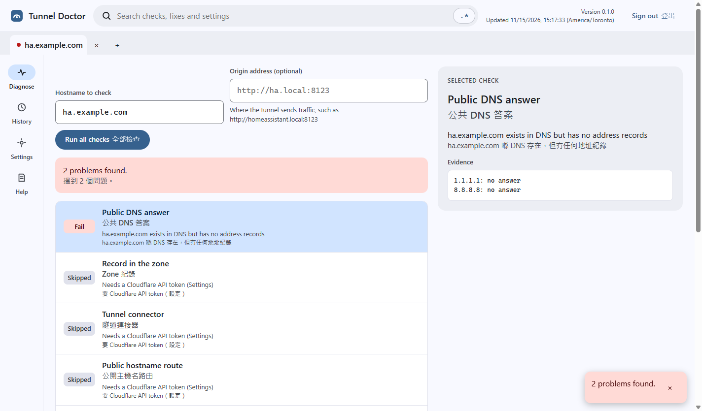
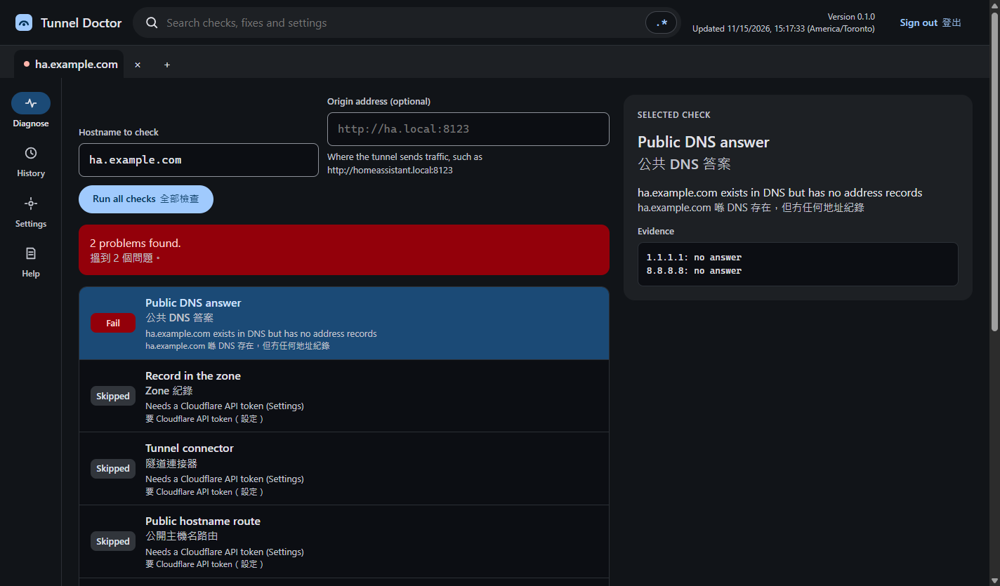
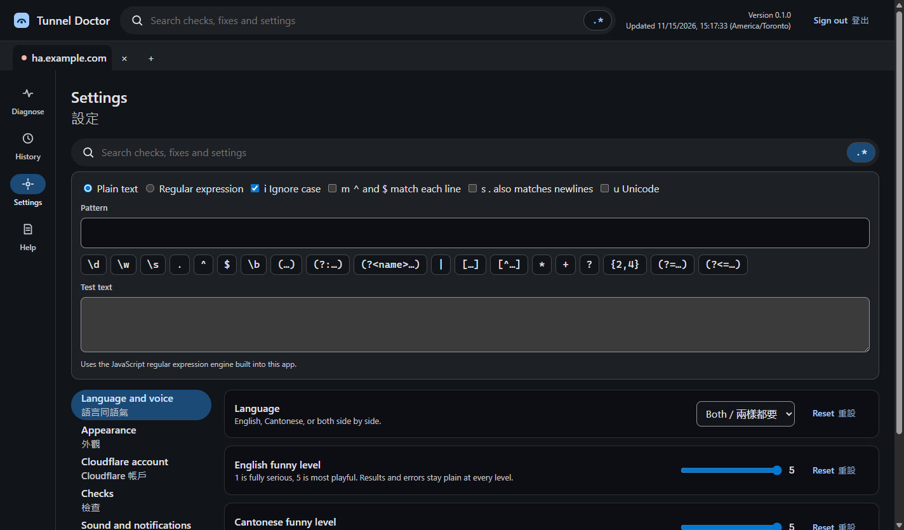
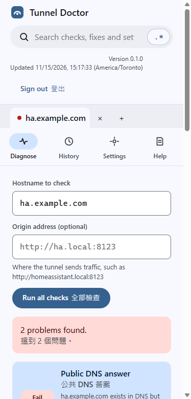

# Tunnel Doctor

Find out why a Cloudflare Tunnel hostname is down, then fix it after you confirm.

Tunnel Doctor checks the whole path a visitor takes: public DNS, the record in
your zone, the tunnel connector, the tunnel's public hostname route, the
Cloudflare edge, and the service behind it (with a specific check for
Home Assistant's reverse-proxy settings). It names the one thing that is wrong
and offers a fix you preview and confirm before anything changes.

**Project site and documentation:** https://ding-ding-projects.github.io/tunnel-doctor/

> **Status: early release.** The checks, fixes, Windows installer and
> Docker-hosted web app work and are released. The appliance image does not
> build yet. See [ROADMAP.md](ROADMAP.md) for exactly what is done and verified.



| Dark theme | Settings with regex builder | Phone width |
| --- | --- | --- |
|  |  |  |

## Problems it catches

| Symptom | What Tunnel Doctor finds | Fix |
| --- | --- | --- |
| "Could not resolve host" / browser can't connect | Tunnel CNAME with the proxy switched off, so DNS hands out a private `fd10::` address | Turn the proxy on |
| Hostname resolves nowhere | No DNS record for a tunnel route | Create a proxied CNAME |
| Error 1033 | Tunnel connector down or not running | Explains the connector state |
| 502 / 530 | Route points at an origin that refuses or is unreachable | Names refused vs unreachable vs timeout |
| Home Assistant `400: Bad Request` | `use_x_forwarded_for` / `trusted_proxies` not set | Shows the exact settings |
| Works on one computer, not another | This computer's DNS cache holds an old answer | Flush the cache (desktop app) |
| Security | Tunnel token visible in a process command line | Explains a safer setup |

## Three ways to run it

| Form | Use it when |
| --- | --- |
| Windows desktop app | You want every check, including this computer's DNS cache |
| Docker-hosted web app | You want it always on your network, reachable from any browser |
| Appliance OS image | You want a small dedicated machine or VM that boots straight into it |

## Install

- **Windows desktop app:** download `TunnelDoctorSetup.exe` from the
  [latest release](https://github.com/Ding-Ding-Projects/tunnel-doctor/releases/latest).
  It is not code-signed, so Windows shows an unknown-publisher warning.
- **Docker-hosted web app:** download `compose.yaml` and `host.bat`, then run
  `host.bat --detached` (or `docker compose up -d`). It prints the LAN address.
  The first visit asks you to create a password. See
  [docs/features/hosting](docs/features/hosting/README.md).
- **Appliance image:** see [appliance/README.md](appliance/README.md). Not built yet.

## Build from source on Windows

```bat
.\build.bat --run
```

That installs Node.js if it is missing, installs dependencies, runs the tests
and opens the desktop app. `build-installer.bat` produces the Squirrel
installer in `out\make\squirrel.windows\x64`.

## Develop

```bash
npm test
```

## Design

The interface design lives in [`design/tunnel-doctor-canvas/`](design/tunnel-doctor-canvas/).

## Licence

MIT. Not affiliated with Cloudflare or Home Assistant.
